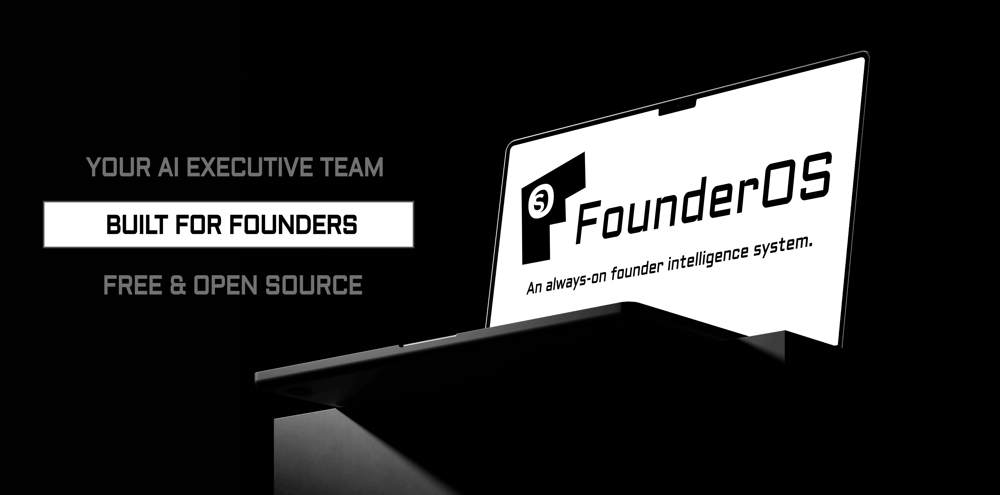

<p align="center">
  
</p>

<p align="center">
  <strong>An always-on founder intelligence system and AI executive team built for early-stage startup founders.</strong>
</p>

<p align="center">
  <a href="./LICENSE"></a>
  
  
  
  
</p>

<p align="center">
  
  
  
  
  
  
</p>

> **🚧 Status: Under Active Development**  
> FounderOS is actively being built and refined. Core agent harnesses, C-suite executive tools, and automated workflows are rapidly evolving. Feedback, issues, and contributions are welcomed!

---

## ⚡ What is FounderOS?

FounderOS is an open-source **AI Executive Operating System** that acts as an autonomous co-founder for early-stage startup leaders. Rather than isolated chatbots, FounderOS builds a living model of your company, grounds all reasoning in your real-time financial constraints and founder DNA, runs authentic multi-agent C-suite board debates with peer cross-examinations, tracks token burn & telemetry ROI, and prepares verified, approval-gated execution drafts.

```
┌─────────────────────────────────────────────────────────────────────────────────┐
│                              1. SIGNAL INGESTION                                │
│          Email  •  Linear  •  Stripe  •  Slack  •  Financials & Metrics         │
└────────────────────────────────────────┬────────────────────────────────────────┘
                                         │
                                         ▼
┌─────────────────────────────────────────────────────────────────────────────────┐
│                         2. COMPANY INTELLIGENCE LAYER                           │
│       Company Context  •  Financial Constraints  •  Institutional Memory        │
└────────────────────────────────────────┬────────────────────────────────────────┘
                                         │
                                         ▼
┌─────────────────────────────────────────────────────────────────────────────────┐
│                          3. 6-AGENT C-SUITE BOARD                               │
│  ┌───────────┐ ┌───────────┐ ┌───────────┐ ┌───────────┐ ┌───────────┐ ┌───────────┐  │
│  │    CRO    │ │Skeptic/CPO│ │   VP CS   │ │    CFO    │ │    CTO    │ │    COO    │  │
│  │ Reforge & │ │Pre-Mortem │ │Superhuman │ │Default    │ │Boring Tech│ │Barrels &  │  │
│  │ MEDDPICC  │ │& Friction │ │PMF Engine │ │Alive/Burn │ │& Two-Way  │ │Ammunition │  │
│  └─────┬─────┘ └─────┬─────┘ └─────┬─────┘ └─────┬─────┘ └─────┬─────┘ └─────┬─────┘  │
│        └─────────────┴─────────────┼─────────────┴─────────────┴─────────────┘    │
│                                    ▼                                              │
│                  2-ROUND DIALECTIC CROSS-EXAMINATION                              │
│             Skeptic vs. CTO  •  CFO vs. CRO  •  VP CS vs. COO                     │
│                                    │                                              │
│                                    ▼                                              │
│                            CEO Orchestrator                                       │
│          Consensus Rating  •  One Metric That Matters  •  2-Week MVE              │
└────────────────────────────────────────┬────────────────────────────────────────┘
                                         │
                                         ▼
┌─────────────────────────────────────────────────────────────────────────────────┐
│                           4. FOUNDER ACTION COCKPIT                             │
│   Daily Morning Brief  ──►  Approval-Gated Drafts  ──►  Decision Ledger (Learn) │
└─────────────────────────────────────────────────────────────────────────────────┘
```

---

## 🌟 Key Capabilities

- **Deep Founder & Company Harness**: Grounds every AI agent decision in your exact business model, cash runway, burn rate, GTM motion, competitive moat, tech stack, and founder superpower/gap profile.
- **👑 C-Suite Daily Executive Operating Suite**:
  - **CEO Investor Update Synthesizer**: Ingests real-time milestones, MRR growth, and constraints to generate gold-standard YC/Sequoia monthly investor updates ready to stage to the Action Queue.
  - **Task Prioritizer**: Automatically segments founder task queues into **10x Leverage** (deep work protection), **1x Neutral**, and **<0.1x Overhead** (auto-delegated to AI workers).
  - **CFO Default Alive Runway Lab**: Real-time Paul Graham capital efficiency simulator modeling headcount changes, salaries, revenue growth deltas, and tooling spend.
  - **CTO & ADR Lab**: Simulates catastrophic failure modes 6 months into the future before committing code; enforces Dan McKinley Boring Tech innovation token discipline.
  - **CRO MEDDPICC Deal Health Radar**: Audits enterprise pipeline deals across 8 dimensions (Metrics, Economic Buyer, Decision Criteria/Process, Paper Process, Pain, Champion, Competition) with objection talk tracks.
  - **VP CS Superhuman PMF Engine**: Analyzes customer sentiment against Rahul Vohra's 40% "Very Disappointed" benchmark and segments High-Expectation Customers (HXC).
- **2-Round Multi-Agent Board Debate Dialectic & Live SSE Streaming**:
  - *Round 1 (Stance Formulation)*: 6 C-suite personas formulate independent perspectives.
  - *Round 2 (Dialectic Tension Pairs)*: Direct rebuttals (Skeptic vs. CTO, CFO vs. CRO, VP CS vs. COO).
  - *Round 3 (CEO Synthesis)*: Consensus rating, One Metric That Matters (OMTM), 2-Week Minimum Viable Experiment (MVE), and failure kill criteria.
  - *Server-Sent Events (SSE)*: Live streaming via `GET /api/debate/stream` visualizes perspectives as they materialize.
- **AI Observability & Cost Telemetry Ledger**: Tracks real-time token burn (prompt, completion, reasoning), latency (ms), and financial costs ($ USD) across OpenAI, Anthropic, Gemini, DeepSeek, Groq, and Ollama with a live UI dashboard card.
- **Multi-Tenant JWT Authentication & RBAC Engine**: Secure PBKDF2-HMAC-SHA256 password hashing, cryptographically signed access tokens, and role-based permissions (`OWNER`, `ADMIN`, `MEMBER`, `VIEWER`).
- **Sandboxed Tool Execution Guard (`ExecutionSandbox`)**: Subprocess isolation with automatic environment credential scrubbing (`AWS_*`, `VAULT_*`, `*_SECRET`, `*_KEY`), strict 5-second execution deadlines, and memory caps.
- **CEO Executive Morning Briefing**: Daily synthesized briefing answering *"What changed overnight and what is the single highest-leverage focus today?"* based on incoming signals.
- **Autonomous Approval-Gated Task Execution**: Automatically processes delegated tasks into verified draft action receipts awaiting founder sign-off.
- **Tri-Modal Security Postures & Policy Filter**: Configurable security postures (`Strict`, `Auto`, `Dangerous`) with automated AST/regex command safety rules to protect startup assets.
- **Scoped Notebook Memory & Decision Ledger**: Line-oriented Markdown institutional memory with SHA-256 revision hashing and 300-fact sliding window cap.
- **100% Offline Peak Local Reasoning**: Operates out-of-the-box with zero API keys required using structured local heuristics.
- **AES-256-GCM Vault**: Authenticated encryption at rest for third-party OAuth refresh tokens and provider API keys with 0600 file permission enforcement.

---

## 🏗️ Architecture & Tech Stack

| Layer | Technologies |
|---|---|
| **Frontend Cockpit** | React 18, TypeScript, Vite, Modular Views & Modals, Glassmorphism UI |
| **Backend Core** | Python 3.10+, FastAPI, Pydantic v2, WebSockets & Server-Sent Events (SSE) |
| **Data & Storage** | SQLModel / SQLAlchemy (Async), SQLite WAL mode / PostgreSQL compatible, Alembic Migrations |
| **Pub/Sub Messaging** | Distributed Redis Broadcast Backend with seamless in-memory fallback |
| **Security & Vault** | AES-256-GCM Authenticated Encryption, ExecutionSandbox env scrubbing, PBKDF2 & HMAC-SHA256 JWT |
| **AI Reasoning Layer** | Universal LLM Connector Registry (Hermes / OpenClaw architecture) supporting the full 2026 intelligence leaderboard: Anthropic (**Claude Opus 5 max**, **Claude Fable 5 with fallback**, **Sonnet 5**), OpenAI (**GPT-5.6 Sol max**, **Luna max**, **o3-mini**), xAI (**Grok 4.6 high/xhigh**), Moonshot AI (**Kimi K3 max 2.8T**), Google Gemini (**Gemini 3.7 Flash high**, **3.1 Pro**), DeepSeek (**DeepSeek V4 Pro max**, **R1**), Zhipu AI (**GLM-5.2 max**), NVIDIA NIM (**Nemotron 3 Ultra**), Meta / Muse (**Muse Spark 1.2 xhigh**), Groq LPUs, OpenRouter (200+ models), and Local Ollama with live `/v1/models` auto-discovery |

---

## 🚀 Quickstart

### Prerequisites
- **Node.js**: v18 or higher
- **Python**: v3.10 or higher

### 1. Frontend Setup

```bash
# Install dependencies
npm install

# Start Vite development server
npm run dev
```
> The frontend will launch at `http://localhost:5173`.

### 2. Backend Setup

```bash
# Navigate to the backend directory
cd server

# Create and activate a virtual environment
python3 -m venv venv
source venv/bin/activate  # On Windows: venv\Scripts\activate

# Install dependencies
pip install -r requirements.txt

# Run database migrations
PYTHONPATH=. ./venv/bin/alembic upgrade head

# Start the FastAPI server with live reload
uvicorn app.main:app --reload --port 8000
```
> The backend API and interactive documentation will be available at `http://localhost:8000/docs`.

### 3. Run Automated Tests (100% Offline)

```bash
PYTHONPATH=server ./server/venv/bin/python -m unittest discover -s server/tests -p "test_*.py" -v
```

---

## 📁 Repository Structure

```
FounderOS/
├── public/                # Static assets & web manifest
├── media/                 # Branding, illustrations & banner assets
├── src/
│   ├── App.tsx            # Application shell & state coordination
│   ├── api.ts             # Typed API client with SSE streaming & auth headers
│   ├── domain.ts          # TypeScript interfaces & domain models
│   ├── views/             # Modular view components:
│   │   ├── OverviewView.tsx
│   │   ├── TasksView.tsx
│   │   ├── ExecutiveView.tsx
│   │   ├── DecisionsView.tsx
│   │   ├── IntelligenceView.tsx
│   │   ├── CompanyView.tsx
│   │   ├── ConnectionsView.tsx
│   │   ├── ModelsView.tsx     # Model gateway & Live AI Token Burn card
│   │   └── OnboardingView.tsx
│   ├── modals/            # Extracted modal dialogs:
│   │   ├── DebateModal.tsx    # Real-time SSE streaming debate modal
│   │   ├── MorningBriefingModal.tsx
│   │   ├── NewDecisionModal.tsx
│   │   ├── NewTaskModal.tsx
│   │   ├── PreviewActionModal.tsx
│   │   ├── SignalModal.tsx
│   │   ├── AskFounderOSModal.tsx
│   │   └── NotificationsDropdown.tsx
│   └── styles.css         # Glassmorphism design system & utility styles
├── server/
│   ├── alembic/           # Alembic revision ledger & migration scripts
│   │   └── versions/      # Versioned schema migrations
│   ├── app/
│   │   ├── main.py        # FastAPI entrypoint & background workers lifecycle
│   │   ├── models.py      # SQLModel database schemas (User, TokenUsageLedger, etc.)
│   │   ├── db.py          # Async session maker, engine & SQLite WAL config
│   │   ├── auth.py        # PBKDF2 hashing, JWT engine, RBAC & tenant scoping
│   │   ├── vault.py       # AES-256-GCM token encryption with 0600 key guard
│   │   ├── rag.py         # 384-dimensional subword morphological vectorizer
│   │   ├── policy/        # Security postures, command safety & ExecutionSandbox
│   │   ├── routers/       # API endpoints (workspace, debate, auth, observability, etc.)
│   │   ├── services/      # LLMEngine, telemetry cost ledger, event bus, briefing
│   │   └── workers/       # Background execution, ingest, and review scheduler loops
│   ├── tests/             # 77 unit & integration tests (100% offline, mocked)
│   └── requirements.txt   # Python dependencies
├── architecture.md        # Authoritative system design & architecture specification
├── harness.md             # AI Agent Harness specification & mental models reference
├── CONTRIBUTING.md        # Open-source contribution guidelines
├── SECURITY.md            # Security disclosure policy
└── LICENSE                # MIT License
```

---

## 📜 License & Contributing

- **License**: Released under the [MIT License](./LICENSE).
- **Contributing**: Please read our [Contributing Guidelines](./CONTRIBUTING.md) and [Code of Conduct](./CONTRIBUTING.md#code-of-conduct) before submitting pull requests.
